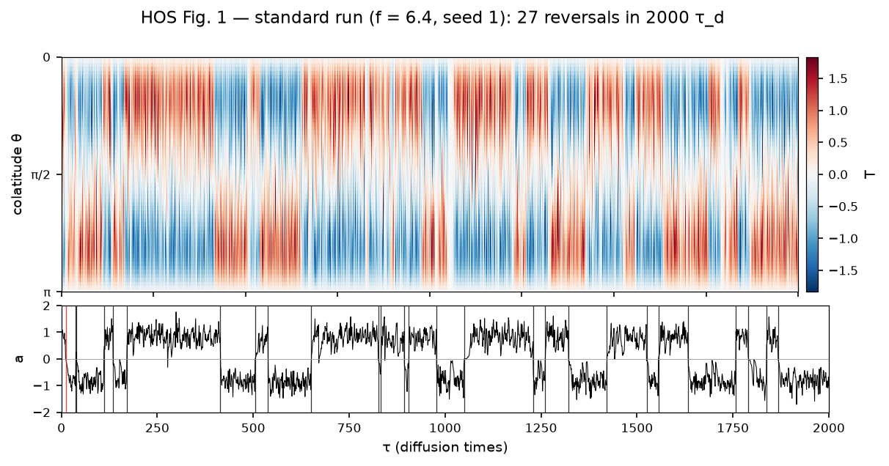
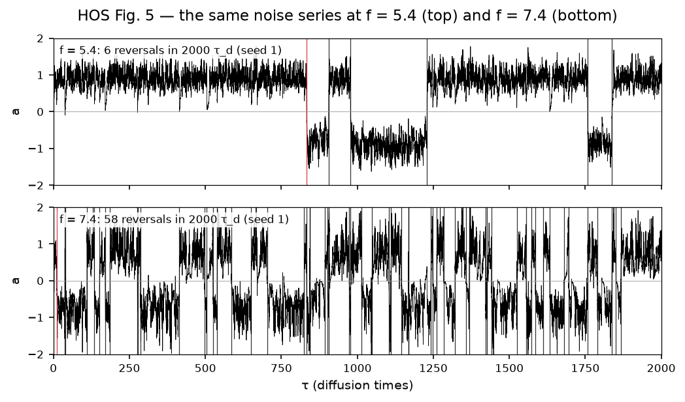
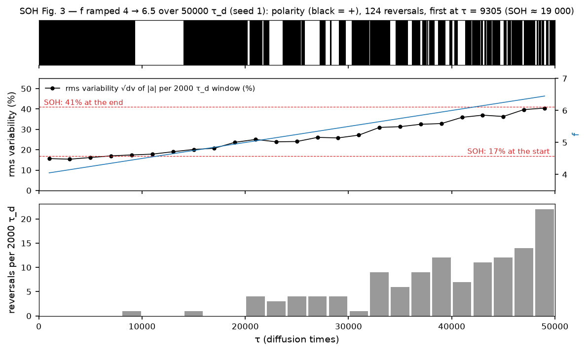
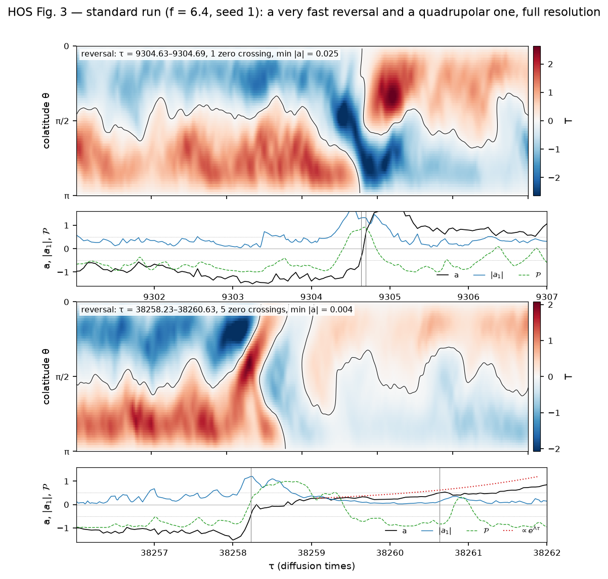
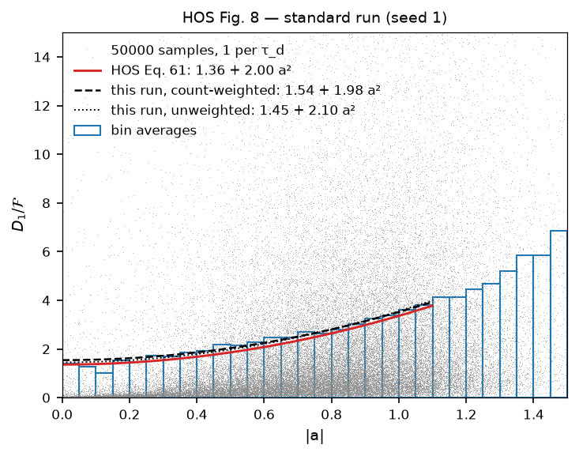
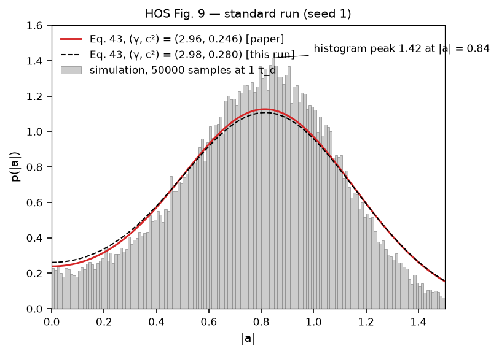
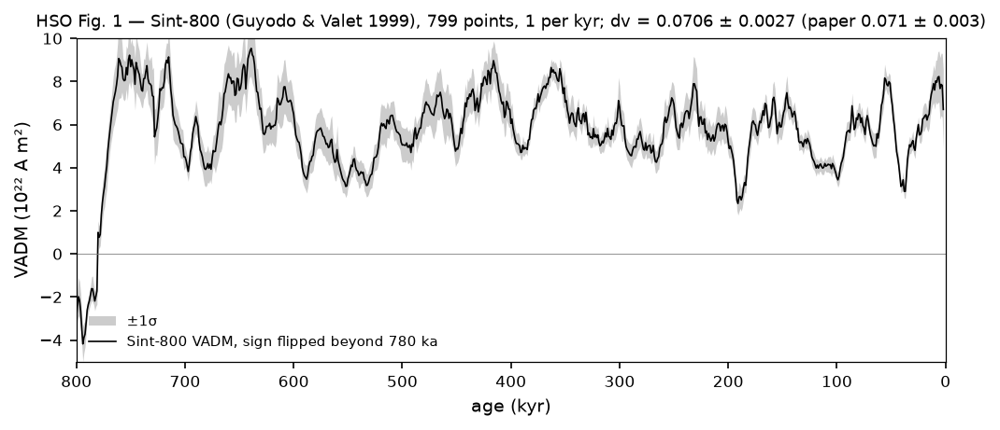

# HoyngDynamo.jl

A fast, modern implementation of the bistable-oscillator geodynamo: the one-dimensional (colatitude) stochastic αΩ mean-field dynamo of Hoyng, Ossendrijver & Schmitt (2001, "HOS"), Schmitt, Ossendrijver & Hoyng (2001, "SOH") and Hoyng, Schmitt & Ossendrijver (2002, "HSO"). Random fluctuations of the α-effect excite damped overtones whose back-reaction turns the dipole amplitude into an overdamped particle in a bistable potential; secular variation and reversals follow from one mechanism.



*The standard run (f = 6.4): the toroidal field T(θ, τ) and the dipole amplitude a(τ), which sits in one well of the potential until a burst of the overtones carries it across. HOS Fig. 1, rendered from this package.*

The package holds the whole model: the eigenproblem, the exponential time stepper, the binned stochastic α, running aggregators that reduce a run as it streams, the closed-form Fokker–Planck theory of HOS §4, HDF5 output and bitwise checkpoint/resume. A step costs 2.3 µs with every statistic running. The papers' results are the validation gates; every gate is passed or, where a paper could not be reproduced, recorded in `dev/DISCREPANCIES.md`.

## What it reproduces

**Reversals and their rate.** HOS Table II is reproduced at all five forcings: the mean time between reversals from 19 to 11 000 τ_d within the paper's errors, the variance column and the Poisson statistics of the polarity intervals. The HSO runs reproduce HSO Tables 1 and 2, SOH's ramped run reproduces the rise of the rms variability from 17% to 41% as the chrons shorten, and the reversals last about 3 τ_d under HOS's definition and 0.5–2 τ_d under HSO's.

| The forcing sets the rate: the same noise at f = 5.4 and 7.4 (HOS Fig. 5) | Ramping f from 4 to 6.5: polarity, variability, reversals per window (SOH Fig. 3) |
|:-:|:-:|
|  |  |

<p align="center"></p>

*Two reversals at full resolution, a very fast one and a quadrupolar one (HOS Fig. 3): the overtone a₁ grows, the parity 𝒫 swings to +1, and the dipole crosses zero.*

**The Fokker–Planck description.** The drift coefficient D₁(a) and the amplitude distribution of a run are fitted as in the papers (HOS Figs. 8 and 9). The shape parameters agree with the papers where the fit is well conditioned, f ≥ 7.4; the intercept at smaller f is the first open point below.

| The drift coefficient D₁/ℱ against \|a\| with HOS's fit (HOS Fig. 8) | The distribution p(\|a\|) against HOS Eq. 43 (HOS Fig. 9) |
|:-:|:-:|
|  |  |

**The Earth.** The Sint-800 record of Guyodo & Valet (1999), kept in `data/`, gives the dipole variation dv = 0.0706 ± 0.0027 against HSO's 0.071 ± 0.003. The χ² fits of the stationary distribution to the VADM histogram land in HSO's valley with the same peak VADM, the autocorrelation has HSO's zero crossing and minimum, and HSO's autocorrelation overlap gives τ_d = 12 kyr for the reference run and 20 kyr for the second against their 11 ± 2 and 16 ± 4 kyr.



*The Sint-800 record (HSO Fig. 1): 799 points at 1 kyr, the sign flipped beyond the Brunhes–Matuyama reversal.*

**What is not reproduced** (`dev/DISCREPANCIES.md`):

- **DR-5.** The intercept of the D₁ fit and c² miss the 10% gate at f ≤ 6.4. Backward-Euler and Crank–Nicolson steppers at the papers' Δτ (stretch goal SG-1) reproduce our values, so the time integrator is excluded and the gap stays open.
- **DR-7.** The parity between reversals sits at −0.82 where HOS say "≃ −1".
- **DR-8.** HOS's three alternative quenching laws (stretch goal SG-2) do not leave the statistics unchanged: two of them run away as written, because an overtone burst reverses the sign of α, and floored at α = 0 they reverse two to seven times more often; the third keeps the rate but raises the variability by 40–50%.
- **DR-9.** HOS's 35-bin fit of Eq. 43 to Sint-800 is at 3.2σ, not the 1σ they report.

## What is here

| Path | Contents |
|---|---|
| `src/`, `test/`, `bench/` | The Julia package `HoyngDynamo`, its tier-tagged tests and the hot-path benchmarks. |
| `scripts/` | One run script per experiment: the standard run, our Table II, the SOH ramp, the reversal events, the Sint-800 comparison, the stretch goals. Output goes to `results/`, git-ignored. |
| `data/` | The Sint-800 record of Guyodo & Valet (1999) with its provenance (`data/README.md`). |
| `viz/` | Python plotting (a uv project: matplotlib, numpy, h5py), one script per paper figure. Reads the HDF5 output and writes `figures/`, git-ignored. Not needed to simulate. |
| `assets/` | The figures embedded in this README, copied from `figures/` by `viz/readme_assets.py`. |
| `dev/` | Development notes: model summary (`DEVELOPMENT.md`), validation gates (`VALIDATION.md`), open questions (`QUESTIONS.md`), implementation decisions (`DECISIONS.md`), discrepancies with the papers (`DISCREPANCIES.md`), stretch goals (`STRETCH_GOALS.md`). |
| `resources/` | Verified, agent-readable summaries of the three papers: every equation, parameter, table and result with page references. Start at `resources/README.md`. |

## Using the package

```julia
] add https://github.com/williamjsdavis/hoyng-dynamo
```

Tests and benchmarks, from the repository root. The default suite is Tiers 0–3 and 6, about 4.5 minutes; Tier 4 is the stochastic validation, about 9 minutes on 4 threads:

```sh
julia --project -e 'using Pkg; Pkg.test()'
HOYNG_TIERS=0,1,2,3,4,6 JULIA_NUM_THREADS=4 julia --project -e 'using Pkg; Pkg.test()'
julia bench/run.jl
```

A run is a `RunSpec`; its statistics are observers, NamedTuples of `Probe`s (an extractor of the simulation state, an aggregator behind `fit!`/`merge!`/`value`, a stride in steps) merged with `standard_observers`. `ensemble` runs the seeds in parallel and pools their aggregators:

```julia
using HoyngDynamo
spec = RunSpec(; f = 6.4)
obs = sim -> merge(standard_observers(sim), (a_hist = Probe(amplitude, Histogram(-2.0, 2.0, 400), 1),))
e = ensemble(spec, 1e4; seeds = 1:3, observers = obs)      # e.summary: ⟨T_r⟩, dv, the D₁ fit; e.pooled.a_hist: the pooled histogram
```

An aggregator defined outside the package (a subtype of `Aggregator` extending `fit!`, `value` and `Base.merge!`) works the same way. The sibling repository `hoyng-dynamo-sde` does this to estimate drift and diffusion functions of the dipole amplitude from streamed runs (the online kernel-based regression of Davis 2023) and maps the fitted stochastic differential equation over the (f, C_m) plane.

The figures need a run file and the Python environment:

```sh
julia --project scripts/run_standard.jl          # the standard run: ~15 s, ~130 MB in results/
cd viz && uv sync && uv run python hos_fig01.py  # one script per figure, written to figures/
```

## Validation status

The gates are defined in `dev/VALIDATION.md`, with the results of every tier in its §4.

| Tier | Content | Status |
|---|---|---|
| 0 | linear operator and eigenproblem (Table I, C₀ = 57.9, E₀₀, …) | passed 2026-10-18, 57 tests |
| 1 | deterministic dynamics, noise off (fixed point, growth rate Λ, saturation, 2μ relaxation) | passed 2026-10-18, 42 tests |
| 2 | noise construction and reproducibility, record/stream equivalence | passed 2026-10-19, 362 tests |
| 3 | closed-form Fokker–Planck theory (Table II theory columns) | passed 2026-10-20, 301 tests |
| 4 | stochastic runs: ⟨T_r⟩, variance, the D₁ fit, the forcing sweep, Poisson intervals, the HSO and SOH runs, convergence, event diagnostics | passed 2026-10-20 (`HOYNG_TIERS=4`); the D₁ intercept and c² at f ≤ 6.4 are `@test_broken` (DR-5) and the parity is recorded (DR-7) |
| 5 | thirteen figures of the papers (HOS Figs. 1–6, 8, 9; HSO Figs. 3, 6, 7, 8; SOH Fig. 3), judged by eye | all judged comparable with the originals (2026-10-20 and 2026-10-24) |
| 6 | Sint-800: dv, the VADM χ² fits, the autocorrelation, τ_d by overlap | passed 2026-10-24, 25 tests in the default suite; HOS's 35-bin fit recorded (DR-9) |
| SG-1, SG-2 | the time integrator as the cause of DR-5; HOS's alternative quenching laws | done 2026-10-24: the integrator is excluded; the quenching laws are not "unchanged" (DR-8) |

## The papers

- Hoyng, P., Ossendrijver, M. A. J. H. & Schmitt, D. (2001). The geodynamo as a bistable oscillator. *Geophys. Astrophys. Fluid Dyn.* 94, 263–314. doi:10.1080/03091920108203410
- Schmitt, D., Ossendrijver, M. A. J. H. & Hoyng, P. (2001). Magnetic field reversals and secular variation in a bistable geodynamo model. *Phys. Earth Planet. Inter.* 125, 119–124. doi:10.1016/S0031-9201(01)00237-0
- Hoyng, P., Schmitt, D. & Ossendrijver, M. A. J. H. (2002). A theoretical analysis of the observed variability of the geomagnetic dipole field. *Phys. Earth Planet. Inter.* 130, 143–157. doi:10.1016/S0031-9201(02)00004-3

## Licence

MIT, see `LICENSE`.
